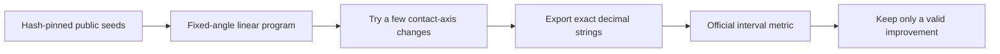

# A Square Deal

Small, reproducible steps toward tighter square packings for [Squares in Squares](https://www.kaggle.com/competitions/squares-in-squares).

We reuse credited numerical packings, test a bounded CPU refinement, and validate the exact exported decimals. Lower scores are better. We claim neither global optimality nor authorship of the public seed packings.

## Results

| Result | Score | Evidence |
|---|---:|---|
| Notebook V1 | 22.6743067475 | Completed Kaggle submission 57498657 |
| Notebook V4 | 22.6021208457 | Completed Kaggle submission 57499680 |
| Refreshed portfolio | 22.34796660625442 | Local official-metric evaluation; 1,000 accepted puzzles and 500,500 rows |
| Planned V5 | **Not yet an official result** | Publication, native run, and notebook-attached submission remain separate stages |

The current candidate source starts with SHA256 `abe2040028c4609a`. Its exact-source full-notebook execution passed in 180.03 seconds. [Validation details](results/local-validation.json) retain the source and output hashes. [Status](results/status.json) keeps local validation separate from publication, a native Kaggle run, and official scoring.

The refreshed score improves the recomputed V4 local baseline by **0.25415423954312644**. Most of that gain comes from newer, credited public witnesses. Our extra refinement contributes **0.00008230149543297927**. On twelve seeds, plain repeated LP supplies most of this smaller gain; contact-axis exchange adds **0.0000013684091344501326** beyond three plain-LP rounds. The exchange method performs more solves. This is not an equal-compute comparison. See [the ablation](results/contact-ablation.json).

## Method



The LP adjusts square centers while holding angles fixed. It chooses a separating axis for each nearby pair. Large dual values identify contacts worth testing. At most four alternative axes are tried per round, for at most three rounds. A small trust region and final interval checks limit numerical risk. Invalid or non-improving proposals keep the original seed.

This extends our earlier fixed-angle LP experiment; the underlying LP and separating-axis ideas are established methods. The measured contribution here is the bounded implementation and its explicit ablation.

## Reproduce one experiment

Use Python 3.12. Install the recorded numerical environment:

```sh
python -m pip install -r requirements.txt
```

Get version 2 of [the frozen public input dataset](https://www.kaggle.com/datasets/prvsiyan/a-square-deal-frozen-public-inputs/versions/2). Retain its source notices. Download **version 17** of [the metric notebook](https://www.kaggle.com/code/metric/squares-in-squares) as `data/squares-in-squares-v17.ipynb`. Select version 17 in Kaggle's version menu; the visible version number is distinct from Kaggle's internal version ID. Extract code cell 0 with exactly one added newline:

```sh
python - <<'PY'
import hashlib, json
from pathlib import Path
cell = json.loads(Path('data/squares-in-squares-v17.ipynb').read_text())['cells'][0]
source = cell['source']
source = ''.join(source) if isinstance(source, list) else source
raw = source.encode()
assert hashlib.sha256(raw).hexdigest() == '312458227c78f56bd5e2eec3dc5fbb8787989422bbf72ce66c3c290048e89733'
with Path('data/metric.py').open('xb') as stream:
    stream.write(raw + b'\n')
PY
```

The runner checks the resulting metric hash and the seed hash before importing the metric.

```sh
python run_experiment.py \
  --seeds data/refresh-20261024-fresh-seeds.json \
  --metric-file data/metric.py \
  --n 928 --rounds 3 --output result-n928.json
```

Use a new output filename. The runner uses one numerical thread, writes only its result file, and makes no network calls. It supports either plain JSON or gzip for the seed file. Kaggle auto-extracts these dataset uploads, so the mounted file can end in `.json` even if the uploaded artifact ended in `.json.gz`. Hashes are checked on the decompressed content.

The metric hash pins the exact exported code used in this experiment. A different export format or newer metric must be reviewed separately; do not disable the check. Solver builds can change the search path. The interval metric, not approximate geometry, decides acceptance.

To reproduce all twelve outcomes, run each size in `results/experiment-summary.json`. The complete frozen seeds and coordinate outputs stay in the dataset, keeping this repository small. `apply_refresh.py` provides our bundle-loading helper. Its loader accepts plain JSON or gzip and requires the hash of the **supplied file bytes**, recorded in `provenance.json`; compressed and extracted files have different hashes. It preserves a stronger incumbent and preserves certified decimal rows during export.

## What did not improve

- Rigidly rotating the V4 packings found **zero** gains above the experiment tolerance across 543 sizes. It ran in about 0.93 seconds. This geometric screen was not independently scored by the interval metric.
- Three of the twelve fresh seeds did not improve: 868, 597, and 647. Their incumbents were retained.
- V2 and V3 failed before submission because pinned public inputs were missing or changed. Those versions remain preserved. V4 used an immutable dataset snapshot.
- The old-V4 clearance-only ablation is a floating geometric estimate. It is not an exact official-metric gain.

## Artifacts and credit

- [Public notebook](https://www.kaggle.com/code/prvsiyan/a-square-deal-research-to-verified-packings) — same identity throughout.
- [Frozen dataset V2](https://www.kaggle.com/datasets/prvsiyan/a-square-deal-frozen-public-inputs/versions/2) — inputs, decimal outputs, provenance, and generated opening artwork.
- [Primary certificate catalogue at the exact commit](https://github.com/franciscouzo/square-packing/tree/1c1715399709bc955e9b402947ab8b52bbacdfc3) — see its individual construction credits.
- [Provenance and asset hashes](provenance.json), [retained artifact hashes](artifact-hashes.json), and [rights notice](NOTICE.md).

The new pastel-square opening image is generated decoration. It is not a packing certificate or a measured scientific figure. The notebook's scientific charts use actual coordinates and measured results.

No competitor notebook prose, artwork, or complete program is copied into this repository. The large numerical files and third-party metric remain at their original public sources. This repository contains our portable experiment, helper, and compact reports.
